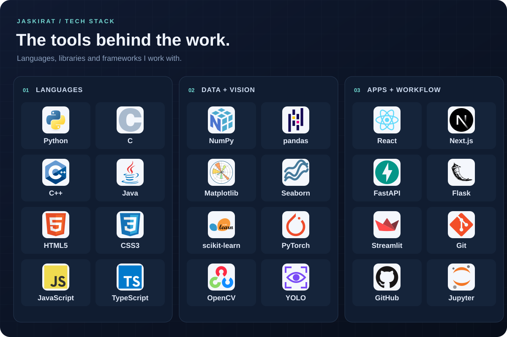

# Jaskirat's Tech Stack

A visual map of the languages, libraries and tools I work with across AI/ML, computer vision and full-stack development.

## Toolkit

| Area | Technologies |
|---|---|
| Languages | Python · C · C++ · Java · HTML · CSS · JavaScript · TypeScript |
| Data and machine learning | NumPy · pandas · Matplotlib · Seaborn · scikit-learn · PyTorch |
| Computer vision | OpenCV · YOLO |
| Applications and APIs | React · Next.js · FastAPI · Flask · Streamlit |
| Development workflow | Git · GitHub · Jupyter |

## See the tools in practice

| Project | Focus | Selected tools |
|---|---|---|
| [Movie Recommendation App](https://github.com/jaskirats01/Movie_Recommendation_App) | Movie discovery and content-based recommendations | Python, FastAPI, Streamlit, scikit-learn |
| [Movie Recommendation Notebook](https://github.com/jaskirats01/Movie_Recommendation_System_ML_Project) | Text preparation, TF-IDF and cosine similarity | pandas, NumPy, scikit-learn, Jupyter |
| [AI Fraud Detection](https://github.com/jaskirats01/AI-Fraud-Detection-System) | Transaction classification and model serving | Python, pandas, scikit-learn, FastAPI, Streamlit |
| [Relief Wing](https://github.com/jaskirats01/relief-wing) | SOS interface and camera-detection prototype | React, TypeScript, Flask, OpenCV, YOLO |
| [AR Space Seekers](https://github.com/jaskirats01/AR_Space_Seekers) | Equipment detection and AR exploration — team project | Next.js, TypeScript, FastAPI, YOLO |

The board describes my toolkit; the linked repositories show selected examples of its use.

## About the artwork

The board is a self-contained SVG so it stays sharp when resized and can be viewed without a badge or statistics service. The text table above provides a readable alternative to the image.

[Icon credits](assets/ATTRIBUTION.md) · [Devicon license](assets/DEVICON-LICENSE.txt) · [Back to my profile](https://github.com/jaskirats01)
